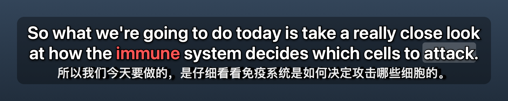
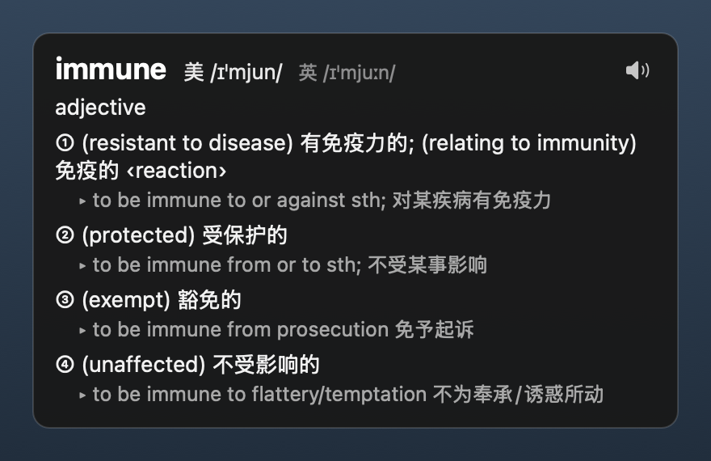

# FloatSubs 悬浮字幕

把 YouTube 的字幕“抠”下来，变成悬浮在 Mac 桌面上的双语字幕，就像网易云音乐的桌面歌词一样。

*Floating, always-on-top bilingual subtitles for YouTube on macOS. It shows Language Reactor's subtitles anywhere on your screen, even when YouTube is in the background. Hover to pause, click a word to look it up and hear it.*



## 为什么做这个

YouTube 上有很多特别好的视频：播客、访谈、讲座、纪录片……但电脑不可能一直停在 YouTube 页面上，我还要写东西、查资料、做别的事。

作为一个英语学习者，我希望一边做事一边“听”这些视频，同时还能随时瞄一眼字幕。于是做了这个小工具：字幕从网页里“抠”出来，浮在屏幕最上层，可以拖到任何地方。就算 YouTube 标签页在后台、浏览器被别的窗口挡住，字幕也会照常滚动。听播客、听访谈都可以。

## 功能

- **双语悬浮字幕**：优先读取 [Language Reactor](https://www.languagereactor.com/)（LR）的双语字幕，没装 LR 时读取 YouTube 自带字幕。
- **永远置顶**：窗口透明、可以拖到任意位置，在全屏视频上也能显示。锁定后鼠标会直接穿透字幕。
- **后台照常更新**：切到别的标签页、窗口被挡住或最小化，字幕都会继续滚动。
- **悬停暂停**：鼠标停在字幕上视频就暂停，移开继续，和 LR 一样。
- **点词查词典**：使用 macOS 自带词典（例如牛津英汉汉英词典），点词时自动朗读美式发音。
- **生词标红**：查过的单词会加入生词本，以后在字幕里出现都显示成红色；双击就能取消。
- **自动分行**：每行大约 42 个字母，超过就分成长度均匀的两行。
- **可以调整**：字号、颜色、每行长度。

## 环境要求

- macOS 12 或更新
- Google Chrome（建议用最新版）
- Xcode 命令行工具，用来在你自己的电脑上编译 Mac 小程序。没装的话，在终端运行：
  ```bash
  xcode-select --install
  ```
- 推荐安装 [Language Reactor](https://www.languagereactor.com/) 插件，双语字幕来自它。

## 安装教程

**1. 下载代码**

```bash
git clone https://github.com/wrab12/floatsubs.git
cd floatsubs
```

也可以点这个页面上的 **Code → Download ZIP**，解压后在终端里进入解压出来的文件夹。

**2. 安装 Mac 小程序**

```bash
bash install.sh
```

它会在本机编译小程序，放到 `~/Applications/FloatSubs.app`，并在 Chrome 里登记它，让插件能启动它。

**3. 安装 Chrome 插件**

1. 在 Chrome 地址栏打开 `chrome://extensions`
2. 打开右上角的「开发者模式」
3. 点「加载已解压的扩展程序」，选择 `floatsubs` 文件夹里的 `extension` 文件夹

**4. 开始使用**

打开一个有字幕的 YouTube 视频，LR 照常开着就行。第一句字幕出现时，悬浮字幕会自动弹出来。

> 插件装好之后，已经打开的 YouTube 页面要刷新一下才会生效。

### 让点词显示中文释义

FloatSubs 用的是 macOS「词典」App 里启用的词典。想看到中文释义：打开「词典」App，进入设置，勾选「牛津英汉汉英词典」，并把它拖到列表最上面。

### 更自然的美式发音（可选）

打开「系统设置 → 辅助功能 → 朗读内容 → 系统声音 → 管理声音」，下载英语（美国）的高级语音，例如 Ava。FloatSubs 会自动使用你电脑上音质最好的美式语音。

## 使用方法

| 操作 | 效果 |
| --- | --- |
| 拖动字幕 | 移动位置，下次打开还在原处 |
| 鼠标停在字幕上 | 视频暂停，移开继续 |
| 单击单词 | 弹出释义并朗读美式发音，这个词加入生词本、标红 |
| 双击红色单词 | 从生词本删除，不再标红 |
| 点释义卡片右上角的喇叭 | 再听一遍发音 |
| 点菜单栏的字幕图标，或在字幕上右键 | 打开设置菜单：锁定（鼠标穿透）、显示原文或翻译、字号、颜色、每行长度、悬停暂停、自动朗读等 |
| 点 Chrome 工具栏上的插件图标 | 开启或关闭悬浮字幕 |



生词本保存在 `~/Library/Application Support/FloatSubs/vocabulary.json`。每条记录单词、原形、加入时间和当时那句字幕，方便以后复习或导出。

## 常见问题

- **插件图标上显示红色 `!`**：Mac 小程序没能启动。鼠标悬停在图标上可以看到原因，通常重新运行 `bash install.sh` 就好。
- **字幕没有出现**：先确认视频有字幕，并且 LR 在 YouTube 页面上正常显示字幕；然后刷新一下 YouTube 页面。
- **插件图标显示 `OFF`**：悬浮字幕被关掉了，点一下图标就会重新开启。
- **LR 更新后读不到字幕**：这时会自动改读 YouTube 自带字幕。欢迎提 Issue。

## 卸载

```bash
bash uninstall.sh
```

然后在 `chrome://extensions` 里移除插件。小程序会被移到废纸篓，生词本会保留。

## 工作原理

```
YouTube 页面（LR 字幕）→ Chrome 插件 → Chrome 原生消息（Native Messaging）→ Mac 悬浮窗
```

- `extension/`：Chrome 插件（Manifest V3）。`content.js` 读取当前字幕，`page.js` 让页面在后台时字幕继续刷新，`background.js` 把字幕转发给 Mac 小程序。
- `mac/main.m`：Mac 小程序（Objective-C），负责悬浮窗、查词、发音和生词本。
- `install.sh` / `uninstall.sh`：编译安装和卸载。

## 隐私

所有处理都在你自己的电脑上完成。字幕只在 Chrome 插件和本机的小程序之间传递，查词用的是 macOS 自带词典，生词本只保存在本机。不收集、不上传任何数据。

## 声明

这是个人开源项目，与 Language Reactor、YouTube 和 Google 都没有关联。

## License

[MIT](LICENSE)

---

如果这个小工具对你有帮助，欢迎点个 ⭐ **Star**，也欢迎 **Follow** 我 [@wrab12](https://github.com/wrab12)！
